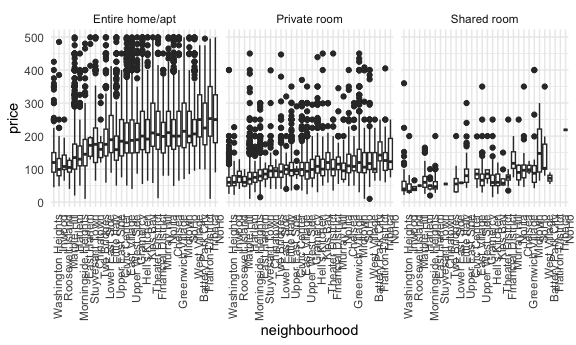
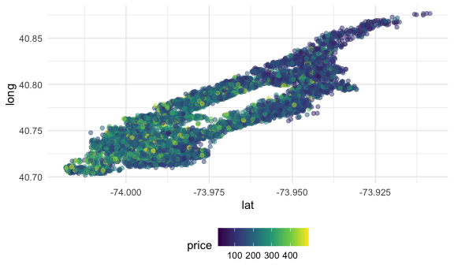

case_study
================
di2251
2026-10-13

``` r
library(p8105.datasets)
data("nyc_airbnb")
library(tidyverse)
```

    ## ── Attaching core tidyverse packages ──────────────────────── tidyverse 2.0.0 ──
    ## ✔ dplyr     1.2.1     ✔ readr     2.2.0
    ## ✔ forcats   1.0.1     ✔ stringr   1.6.0
    ## ✔ ggplot2   4.0.3     ✔ tibble    3.3.1
    ## ✔ lubridate 1.9.5     ✔ tidyr     1.3.2
    ## ✔ purrr     1.2.2     
    ## ── Conflicts ────────────────────────────────────────── tidyverse_conflicts() ──
    ## ✖ dplyr::filter() masks stats::filter()
    ## ✖ dplyr::lag()    masks stats::lag()
    ## ℹ Use the conflicted package (<http://conflicted.r-lib.org/>) to force all conflicts to become errors

``` r
knitr::opts_chunk$set(
  fig.width = 6,
  fig.asp = .6,
  out.width = "90%"
)

theme_set(theme_minimal() + theme(legend.position = "bottom"))

options(ggplot2.continuous.colour = "viridis", ggplot2.continuous.fill = "viridis")

scale_colour_discrete = scale_colour_viridis_d()
scale_fill_discrete()
```

    ## <ggproto object: Class ScaleDiscrete, Scale, gg>
    ##     aesthetics: fill
    ##     axis_order: function
    ##     break_info: function
    ##     break_positions: function
    ##     breaks: waiver
    ##     call: call
    ##     clone: function
    ##     dimension: function
    ##     drop: TRUE
    ##     expand: waiver
    ##     fallback_palette: function
    ##     get_breaks: function
    ##     get_breaks_minor: function
    ##     get_labels: function
    ##     get_limits: function
    ##     get_transformation: function
    ##     guide: legend
    ##     is_discrete: function
    ##     is_empty: function
    ##     labels: waiver
    ##     limits: NULL
    ##     make_sec_title: function
    ##     make_title: function
    ##     map: function
    ##     map_df: function
    ##     minor_breaks: waiver
    ##     n.breaks.cache: NULL
    ##     na.translate: TRUE
    ##     na.value: grey50
    ##     name: waiver
    ##     palette: NULL
    ##     palette.cache: NULL
    ##     position: left
    ##     range: environment
    ##     rescale: function
    ##     reset: function
    ##     train: function
    ##     train_df: function
    ##     transform: function
    ##     transform_df: function
    ##     super:  <ggproto object: Class ScaleDiscrete, Scale, gg>

``` r
scale_fill_viridis_d()
```

    ## <ggproto object: Class ScaleDiscrete, Scale, gg>
    ##     aesthetics: fill
    ##     axis_order: function
    ##     break_info: function
    ##     break_positions: function
    ##     breaks: waiver
    ##     call: call
    ##     clone: function
    ##     dimension: function
    ##     drop: TRUE
    ##     expand: waiver
    ##     fallback_palette: function
    ##     get_breaks: function
    ##     get_breaks_minor: function
    ##     get_labels: function
    ##     get_limits: function
    ##     get_transformation: function
    ##     guide: legend
    ##     is_discrete: function
    ##     is_empty: function
    ##     labels: waiver
    ##     limits: NULL
    ##     make_sec_title: function
    ##     make_title: function
    ##     map: function
    ##     map_df: function
    ##     minor_breaks: waiver
    ##     n.breaks.cache: NULL
    ##     na.translate: TRUE
    ##     na.value: NA
    ##     name: waiver
    ##     palette: function
    ##     palette.cache: NULL
    ##     position: left
    ##     range: environment
    ##     rescale: function
    ##     reset: function
    ##     train: function
    ##     train_df: function
    ##     transform: function
    ##     transform_df: function
    ##     super:  <ggproto object: Class ScaleDiscrete, Scale, gg>

Understanding variables:

``` r
# View(nyc_airbnb)

str(nyc_airbnb)
```

    ## spc_tbl_ [40,753 × 17] (S3: spec_tbl_df/tbl_df/tbl/data.frame)
    ##  $ id                            : num [1:40753] 7949480 16042478 1886820 6627449 5557381 ...
    ##  $ review_scores_location        : num [1:40753] 10 NA NA 10 10 10 10 9 10 9 ...
    ##  $ name                          : chr [1:40753] "City Island Sanctuary relaxing BR & Bath w Parking" "WATERFRONT STUDIO APARTMENT" "Quaint City Island Community." "Large 1 BDRM in Great location" ...
    ##  $ host_id                       : num [1:40753] 119445 9117975 9815788 13886510 28811542 ...
    ##  $ host_name                     : chr [1:40753] "Linda & Didier" "Collins" "Steve" "Arlene" ...
    ##  $ neighbourhood_group           : chr [1:40753] "Bronx" "Bronx" "Bronx" "Bronx" ...
    ##  $ neighbourhood                 : chr [1:40753] "City Island" "City Island" "City Island" "City Island" ...
    ##  $ lat                           : num [1:40753] -73.8 -73.8 -73.8 -73.8 -73.8 ...
    ##  $ long                          : num [1:40753] 40.9 40.9 40.8 40.8 40.9 ...
    ##  $ room_type                     : chr [1:40753] "Private room" "Private room" "Entire home/apt" "Entire home/apt" ...
    ##  $ price                         : num [1:40753] 99 200 300 125 69 125 85 39 95 125 ...
    ##  $ minimum_nights                : num [1:40753] 1 7 7 3 3 2 1 2 3 2 ...
    ##  $ number_of_reviews             : num [1:40753] 25 0 0 12 86 41 74 114 5 206 ...
    ##  $ last_review                   : Date[1:40753], format: "2017-04-23" NA ...
    ##  $ reviews_per_month             : num [1:40753] 1.59 NA NA 0.54 3.63 2.48 5.43 2.06 5 2.98 ...
    ##  $ calculated_host_listings_count: num [1:40753] 1 1 1 1 1 1 1 4 3 4 ...
    ##  $ availability_365              : num [1:40753] 170 180 365 335 352 129 306 306 144 106 ...

``` r
nyc_airbnb |>
  count(room_type, neighbourhood_group)
```

    ## # A tibble: 15 × 3
    ##    room_type       neighbourhood_group     n
    ##    <chr>           <chr>               <int>
    ##  1 Entire home/apt Bronx                 192
    ##  2 Entire home/apt Brooklyn             7427
    ##  3 Entire home/apt Manhattan           10814
    ##  4 Entire home/apt Queens               1388
    ##  5 Entire home/apt Staten Island         116
    ##  6 Private room    Bronx                 429
    ##  7 Private room    Brooklyn             9000
    ##  8 Private room    Manhattan            7812
    ##  9 Private room    Queens               2241
    ## 10 Private room    Staten Island         144
    ## 11 Shared room     Bronx                  28
    ## 12 Shared room     Brooklyn              383
    ## 13 Shared room     Manhattan             586
    ## 14 Shared room     Queens                192
    ## 15 Shared room     Staten Island           1

``` r
nyc_airbnb |>
  filter(neighbourhood_group == "Manhattan") |>
  filter(price < 500) |>
  mutate(neighbourhood = fct_reorder(neighbourhood, price)) |>
  ggplot(aes(x = neighbourhood, y = price)) + 
  geom_boxplot() + 
  facet_grid(. ~ room_type) + 
  theme(axis.text.x = element_text(angle = 90, hjust = 1))
```



visualize price some more:

``` r
nyc_airbnb |>
  filter(neighbourhood_group == "Manhattan") |>
  filter(room_type == "Entire home/apt") |>
  filter(price < 500) |>
  ggplot(aes(x = lat, y = long, color = price)) +
  geom_point(alpha = .5)
```



make a leaflet map:
